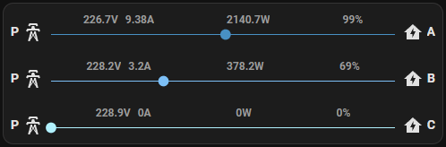

# Energy Overview Card

A simple card which displays energy usage details of one or multiple entities.

[](https://my.home-assistant.io/redirect/hacs_repository/?owner=Sese-Schneider&repository=ha-energy-overview-card&category=frontend)
[![GitHub Release][releases-shield]][releases]
![GitHub Downloads][downloads-shield]

[![License][license-shield]](LICENSE)
[![GitHub Activity][commits-shield]][commits]

**Features:**

- Variable amount of monitoring entities
- Voltage, Current, Power, Frequency and Power Factor display
- Automatic unit of measurement detection and ordering
- Adjustable names, colors, labels and icons
- Configurable dynamic animations adapting to power usage

### Power flow animation

Flow animation stops when power is zero, missing, or unavailable. Negative power
reverses the direction; `inverted` reverses it again. The moving dot is hidden
when your device's **Reduce Motion** accessibility setting is enabled.

Animation speed uses the absolute power value, converted to watts. Supported
power units are `mW`, `W`, `kW`, `MW`, and `BTU/h`.

_Three-phase power monitoring example:_



## Compatibility

Existing `custom:energy-overview-card` YAML options and the
`energy-overview-card.js` filename are retained. The development changes include
missing/unavailable-state handling, updated editor controls, responsive layouts,
and Masonry/Sections sizing.

See [compatibility verification](docs/compatibility.md) for historical checks and
their limitations. Those results do not establish compatibility of this PR's
exact bundle with current Home Assistant or HACS releases. Physical-device and
release-installation verification remain outstanding.

## Configuration

A graphical editor supports adding, selecting, reordering, and deleting entities,
including starting with an empty card. If frontend forms fail to load, use
**Retry** or edit the card in YAML.

After installation, simply press "Add Card", search for "Energy Overview", and add the card.
Now you can start the configuration via the GUI.

Direct configuration via YAML is also available. For details see below.

## Options

| Name      | Type               | Requirement  | Description                                                                                                           | Default    |
| --------- | ------------------ | ------------ | --------------------------------------------------------------------------------------------------------------------- | ---------- |
| type      | string             | **Required** | `custom:energy-overview-card`                                                                                         |            |
| entities  | Array<PowerEntity> | **Required** | List of power entities (see below)                                                                                    |            |
| animation | AnimationConfig    | _Optional_   | Animation configuration (see below)                                                                                   |            |
| order_by  | string             | _Optional_   | Value name of which to sort all entities. Options are: `power`, `voltage`, `current`, `frequency`, and `power_factor` | No sorting |
| title     | string             | _Optional_   | Title of the card                                                                                                     |            |

#### PowerEntity

| Name           | Type            | Requirement  | Description                        | Default                                |
| -------------- | --------------- | ------------ | ---------------------------------- | -------------------------------------- |
| power          | state entity    | **Required** | State entity for power             |                                        |
| voltage        | state entity    | _Optional_   | State entity for voltage           |                                        |
| current        | state entity    | _Optional_   | State entity for current           |                                        |
| frequency      | state entity    | _Optional_   | State entity for frequency         |                                        |
| power_factor   | state entity    | _Optional_   | State entity for power_factor      |                                        |
| name           | string          | _Optional_   | Name label                         |                                        |
| icon_leading   | string          | _Optional_   | Leading MD icon                    | `mdi:transmission-tower`               |
| icon_trailing  | string          | _Optional_   | Trailing MD icon                   | `mdi:home-lightning-bolt`              |
| label_leading  | string          | _Optional_   | Leading label                      |                                        |
| label_trailing | string          | _Optional_   | Trailing label                     |                                        |
| color          | string          | _Optional_   | CSS color                          | `var(--energy-grid-consumption-color)` |
| animation      | AnimationConfig | _Optional_   | Overwrite for the global animation |                                        |

#### AnimationConfig

| Name         | Type    | Requirement | Description                                                                     | Default |
| ------------ | ------- | ----------- | ------------------------------------------------------------------------------- | ------- |
| power        | number  | _Optional_  | Absolute power threshold in watts at which the animation reaches `min_duration` | 1000    |
| min_duration | number  | _Optional_  | Minimum cycle duration in seconds, at or above the power threshold              | 1       |
| max_duration | number  | _Optional_  | Maximum cycle duration in seconds, approached as absolute power approaches zero | 10      |
| inverted     | boolean | _Optional_  | Inverts the animation direction                                                 | false   |

Invalid, non-finite, or nonpositive numeric animation settings fall back to the
defaults above. Durations are bounded between 0.001 and 86400 seconds, and the
maximum duration is never lower than the minimum. Zero power stops animation.

### Example configuration

Minimal configuration:

```yaml
type: custom:energy-overview-card
entities:
  - power: sensor.home_power
```

Replace the example sensor IDs with your own entities. Three-phase example:

```yaml
type: custom:energy-overview-card
entities:
  - power: sensor.a_p
    current: sensor.a_c
    voltage: sensor.a_v
    power_factor: sensor.a_pf
    label_leading: "P"
    label_trailing: "L1"
    icon_leading: "mdi:transmission-tower"
    icon_trailing: "mdi:home-lightning-bolt"
    color: "#488fc2"
  - power: sensor.b_p
    current: sensor.b_c
    voltage: sensor.b_v
    power_factor: sensor.b_pf
    label_leading: "P"
    label_trailing: "L2"
    color: "#7dbff5"
    animation:
      power: 100
      min_duration: 2
      max_duration: 5
  - power: sensor.c_p
    current: sensor.c_c
    voltage: sensor.c_v
    frequency: sensor.c_fq
    power_factor: sensor.c_pf
    label_leading: "P"
    label_trailing: "L3"
    color: "#b1f2ff"
animation:
  power: 1000
  min_duration: 1
  max_duration: 10
```

## Install

### HACS

_This repo is available for install through the HACS._

- Open HACS from the Home Assistant sidebar.
- Search for "Energy Overview Card"; use the **Dashboard** type filter if needed.
- Select the repository and download the card. Reload the browser afterward.

_or_

Click here:

[](https://my.home-assistant.io/redirect/hacs_repository/?owner=Sese-Schneider&repository=ha-energy-overview-card&category=frontend)

### Simple install

- Download and copy `energy-overview-card.js` from the
  latest [release](https://github.com/Sese-Schneider/ha-energy-overview-card/releases/latest) into your `config/www`
  directory.
- Add a reference to `energy-overview-card.js` as JavaScript-Module to your Lovelace dashboard via "Manage Resources". (
  Note: You have to enable advanced mode)

Use `/local/energy-overview-card.js` as the resource URL and **JavaScript module**
as the type. For dashboards with YAML-managed resources, the resource entry is:

```yaml
resources:
  - url: /local/energy-overview-card.js
    type: module
```

Register only one copy of the card. After updating the JavaScript file, refresh
cached dashboard resources by reloading the browser; if the old version persists,
perform a hard refresh or clear the browser cache.

[Troubleshooting](https://github.com/thomasloven/hass-config/wiki/Lovelace-Plugins)

## Publishing releases

Maintainers can run the **Release** workflow from GitHub Actions on `main` or
`dev`. Enter a new version without the `v` prefix: `X.Y.Z` on `main` (for example,
`3.0.0`) or `X.Y.Z-dev.N` on `dev` (for example, `3.1.0-dev.1`). Existing tags
are rejected; versions are selected explicitly rather than calculated from commits.
The input must exactly match `package.json`, including the `-dev.N` suffix for a
prerelease, so the release tag and the bundle's embedded version agree.

The workflow installs locked dependencies and Chromium/WebKit with their system
dependencies, then builds, runs both browser test suites, enforces coverage
thresholds, and validates the HACS package. Only after all checks pass does it
create a `v<version>` tag at the exact workflow commit and a GitHub release
with generated notes and the `energy-overview-card.js` download. Releases from
`dev` are prereleases and are not marked as latest. It also verifies that the
uploaded asset is nonempty; this is not a live HACS installation test. The workflow
does not update `package.json` or `CHANGELOG.md`; maintainers should update those
in the release commit beforehand.

[commits-shield]: https://img.shields.io/github/commit-activity/y/Sese-Schneider/ha-energy-overview-card.svg?style=for-the-badge
[downloads-shield]: https://img.shields.io/github/downloads/Sese-Schneider/ha-energy-overview-card/total.svg?style=for-the-badge
[commits]: https://github.com/Sese-Schneider/ha-energy-overview-card/commits/main
[license-shield]: https://img.shields.io/github/license/Sese-Schneider/ha-energy-overview-card.svg?style=for-the-badge
[releases-shield]: https://img.shields.io/github/release/Sese-Schneider/ha-energy-overview-card.svg?style=for-the-badge
[releases]: https://github.com/Sese-Schneider/ha-energy-overview-card/releases
